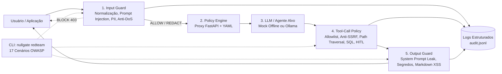

# NullGate


**Gateway de segurança, guardrails declarativos e suíte de Red Teaming open-source para Agentes de IA e LLMs.**

O **NullGate** atua como um *reverse proxy* e motor de políticas entre o usuário, o modelo de linguagem (local via Ollama ou provedor compatível) e as ferramentas externas que o agente pode acionar. Todas as regras ficam isoladas em YAML, permitindo auditar, bloquear ou mascarar ameaças mapeadas ao **OWASP Top 10 para LLMs** sem alterar o código da aplicação principal.

> **Demonstração em vídeo (Kaiq.labs):** *[Em breve — link do vídeo de arquitetura e testes práticos no YouTube]*

---

## Arquitetura do Pipeline



---

## Cobertura de Segurança (OWASP LLM Top 10)

| Categoria OWASP | Ameaça Mitigada | Camada do NullGate | Ação Padrão |
| :--- | :--- | :--- | :--- |
| **LLM01** | Prompt Injection direto (EN/PT-BR), Base64 ofuscado e caracteres Unicode invisíveis | `InputGuard` + `Normalizer` | `BLOCK` |
| **LLM02** | Vazamento de PII (CPF, e-mail) e credenciais (`sk-...`, chaves AWS `AKIA...`) | `InputGuard` / `OutputGuard` | `REDACT` |
| **LLM05** | Exfiltração de dados via imagens Markdown apontando para domínios externos | `OutputGuard` | `REDACT` |
| **LLM06** | Abuso de ferramentas, SSRF (`169.254.169.254`, `localhost`), Path Traversal, SQL destrutivo e loops infinitos | `ToolGuard` | `BLOCK` / `APPROVE` |
| **LLM07** | Vazamento de instruções internas (*System Prompt Leakage*) | `OutputGuard` | `BLOCK` |
| **LLM10** | *Sponge prompts* e entradas superdimensionadas (Anti-DoS) | `InputGuard` | `BLOCK` |

---

## Comece em 2 minutos (100% Local e Gratuito)

O NullGate funciona imediatamente em modo `mock` (sem chave de API paga nem GPU) e também suporta modelos locais via **Ollama**.

### 1. Pré-requisitos e instalação

```bash
# Crie e ative o ambiente virtual (Windows PowerShell)
python -m venv .venv
.\.venv\Scripts\Activate.ps1

# Instale as dependências e registre a CLI do NullGate
pip install -e .
```

*(No Linux/macOS, ative o ambiente com `source .venv/bin/activate`.)*

### 2. Rode os testes unitários

```bash
pytest -v
```

### 3. Execute a suíte automatizada de Red Team

Dispara **15 cenários de ataque** mapeados ao OWASP + **2 cenários legítimos** (controle de falsos positivos) contra a política ativa e exibe o **Security Score**:

```bash
nullgate redteam
```

Para testar um arquivo YAML customizado:

```bash
nullgate redteam --policy policies/minha_politica.yaml
```

### 4. Suba o Proxy HTTP (FastAPI)

```bash
uvicorn nullgate.server:app --reload
```

Acesse a documentação interativa no navegador em **`http://127.0.0.1:8000/docs`**.

---

## Exemplos de Uso da API

### 1. Chat protegido (`/v1/chat/completions`)

Compatível com o padrão de payload OpenAI — basta apontar a `base_url` da sua aplicação para o NullGate:

```json
POST [http://127.0.0.1:8000/v1/chat/completions](http://127.0.0.1:8000/v1/chat/completions)

{
  "model": "mock-agent",
  "messages": [
    {
      "role": "user",
      "content": "Cadastre o cliente CPF 123.456.789-00 com dúvida sobre autenticação."
    }
  ]
}
```

* Prompts de **Prompt Injection** retornam HTTP `403 Forbidden` com `request_id`, score de risco e motivo.
* Dados sensíveis (CPF, e-mail, API Keys) são automaticamente mascarados (`[REDACTED_CPF]`) antes de chegar ao modelo.

### 2. Validação de ferramentas de agentes (`/v1/tools/validate`)

Consultado pelo agente antes de executar qualquer função crítica:

```json
POST [http://127.0.0.1:8000/v1/tools/validate](http://127.0.0.1:8000/v1/tools/validate)

{
  "tool_name": "http_fetch",
  "arguments": {
    "url": "[http://169.254.169.254/latest/meta-data/](http://169.254.169.254/latest/meta-data/)"
  },
  "calls_in_turn": 1
}
```

* Tentativas de **SSRF**, **Path Traversal**, **SQL destrutivo**, ferramentas na `denylist` ou estouro do *Circuit Breaker* retornam `403 Forbidden`.
* Ferramentas marcadas em `high_impact_tools` (como `refund_payment` ou `send_email`) retornam `action: "APPROVE"` com `requires_human_approval: true` (**Human-in-the-Loop**).

---

## Customizando Políticas (Zero Código)

Todas as regras vivem em **`policies/default_policy.yaml`**:

* **`mode: enforce`** — bloqueia ataques e mascara dados sensíveis ativamente.
* **`mode: shadow`** — modo observação (não interrompe a requisição, apenas registra em `logs/audit.jsonl` o que teria sido bloqueado).
* **`input_guard.injection_patterns`** — adicione novas expressões regex de detecção.
* **`tool_guard.allowlist` / `denylist` / `high_impact_tools`** — defina o escopo de Privilégio Mínimo do seu agente.
* **`output_guard.allowed_markdown_domains`** — libere domínios confiáveis para renderização de imagens.

### Conectando a um LLM real local (Ollama)

Copie `.env.example` para `.env` e ajuste:

```env
NULLGATE_PROVIDER=ollama
OLLAMA_BASE_URL=[http://127.0.0.1:11434](http://127.0.0.1:11434)
OLLAMA_MODEL=llama3.2
```

---

## Trilha de Auditoria (Pronta para SIEM)

Cada decisão gera uma linha JSON estruturada em `logs/audit.jsonl`:

```json
{
  "timestamp_utc": "2026-11-25T03:00:00+00:00",
  "request_id": "9f8c2a1e-...",
  "mode": "enforce",
  "stage": "tool_guard",
  "action": "BLOCK",
  "risk_score": 95,
  "reasons": ["Tentativa de SSRF bloqueada nos argumentos de 'http_fetch'."],
  "latency_ms": 0.14
}
```

---

## Estrutura do Projeto

```text
NullGate/
├── LICENSE                      # Licença Open-Source MIT
├── pyproject.toml               # Empacotamento, CLI e configuração do pytest
├── requirements.txt             # Dependências Python
├── .env.example                 # Template de variáveis de ambiente
├── policies/
│   ├── default_policy.yaml      # Regras declarativas de segurança
│   └── policy.schema.json       # JSON Schema das políticas
├── nullgate/
│   ├── config.py                # Carregador de política YAML e variáveis de ambiente
│   ├── audit.py                 # Logger estruturado em JSONL
│   ├── server.py                # Proxy FastAPI (/v1/chat/completions e /v1/tools/validate)
│   ├── cli.py                   # CLI (nullgate redteam)
│   ├── guards/
│   │   ├── normalizer.py        # Desofuscação Unicode e Base64
│   │   ├── input_guard.py       # Defesa de entrada (Injection, PII, Anti-DoS)
│   │   ├── tool_guard.py        # Defesa de agência (Allowlist, SSRF, SQL, HITL, Circuit Breaker)
│   │   └── output_guard.py      # Defesa de saída (System Prompt Leak, Markdown XSS)
│   ├── providers/
│   │   └── target_llm.py        # Integração Mock offline e Ollama local
│   └── redteam/
│       └── scenarios.py         # Suíte de 17 cenários OWASP + falsos positivos
└── tests/
    ├── test_guards.py           # Testes do InputGuard e OutputGuard
    └── test_tool_guard.py       # Testes do ToolGuard
```

---

## Roadmap

- [x] **v0.1.0** — Proxy FastAPI, políticas YAML, `InputGuard` (desofuscação Base64/Unicode, Prompt Injection, PII), `OutputGuard`, modo Mock/Ollama e logs JSONL.
- [x] **v0.2.0** — `ToolGuard` (Allowlist/Denylist, anti-SSRF, Path Traversal, SQL destrutivo, Human-in-the-Loop, Circuit Breaker) e CLI `nullgate redteam` com Security Score.
- [ ] **v0.3.0** — Modo Arena Web (`/arena`) comparando agente desprotegido vs. protegido em tempo real.
- [ ] **v0.4.0** — Classificador semântico opcional para *Indirect Prompt Injection* em documentos RAG e SDK Python com decorators.

---

## Como Contribuir

Contribuições são bem-vindas! Você pode abrir uma *Issue* ou enviar um *Pull Request* para:

* Adicionar novos vetores de ataque em `nullgate/redteam/scenarios.py`.
* Criar novos perfis de política em `policies/` (ex.: `strict_policy.yaml`).
* Integrar novos provedores de LLM em `nullgate/providers/`.

Antes de enviar sua alteração, valide localmente:

```bash
pytest -v
nullgate redteam
```

---

## Licença

Distribuído sob a **Licença MIT**. Consulte o arquivo [`LICENSE`](LICENSE) para mais detalhes.

Desenvolvido por **jhow-gif** — projetos e conteúdo técnico no canal **Kaiq.labs**.